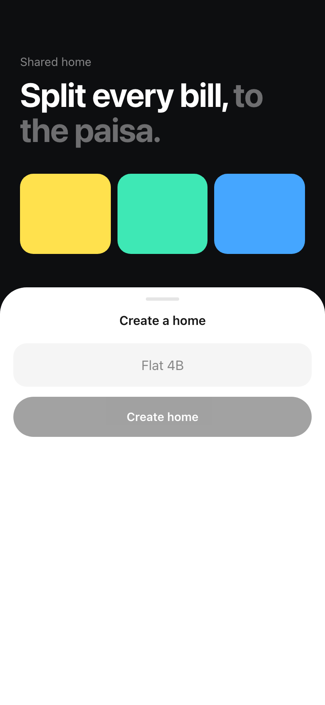
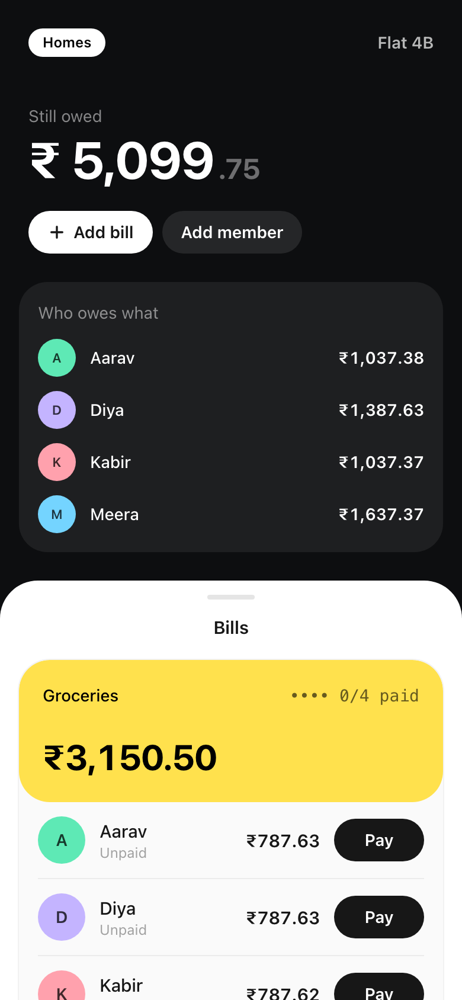
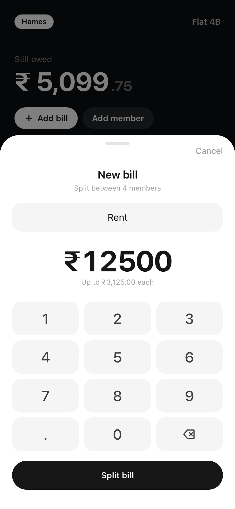
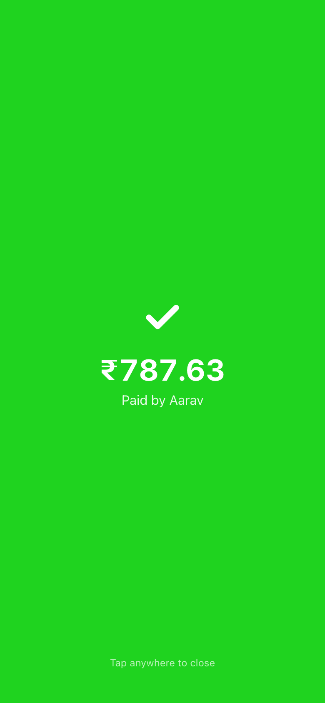
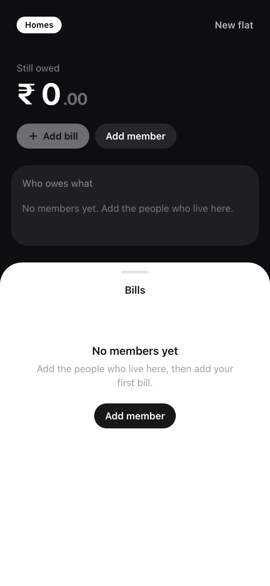
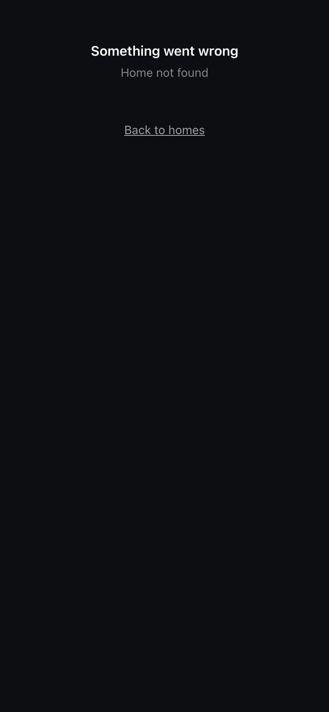
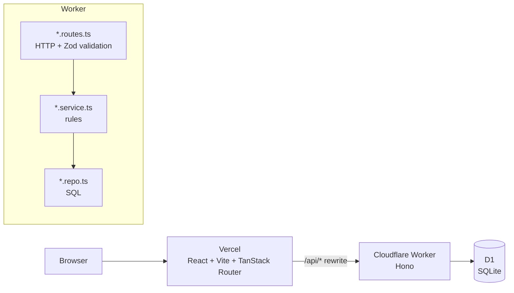
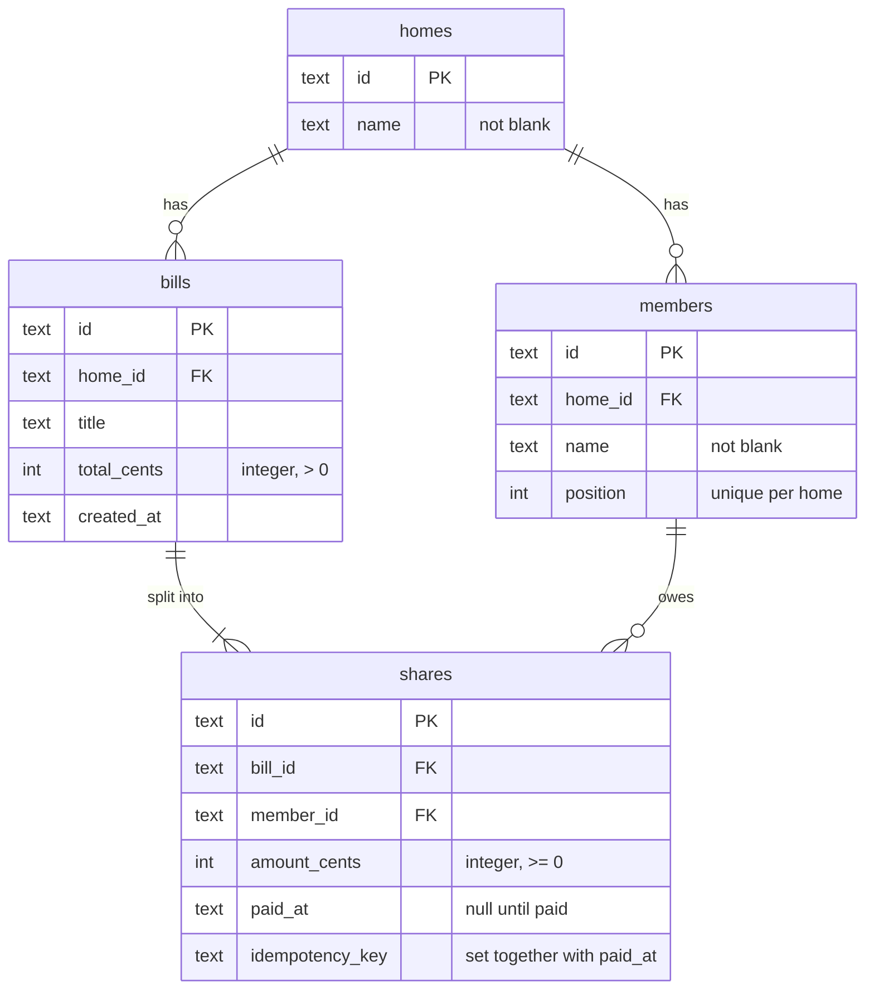
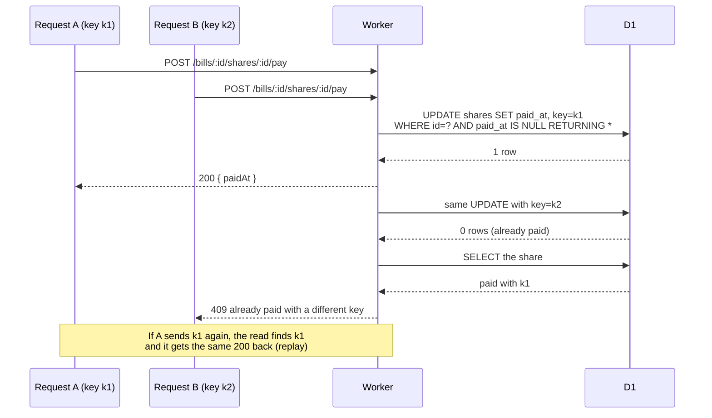

# Shared Bill Splitter

Split the bills of a shared home between its members, down to the last paisa. Each member pays their own share, and a payment can never go through twice.

**Live app:** https://bill-splitter-nu-peach.vercel.app
**Demo home:** https://bill-splitter-nu-peach.vercel.app/homes/4ab8134f-eb49-4db9-ad71-42c173286e6e
**API:** https://bill-splitter-api.duttapraneet.workers.dev/api/health

Built for the [SDE intern assignment](https://github.com/DoCoDeGo-Engineering/sde-intern-task-002) with Hono on Cloudflare Workers, D1, React, Vite and TanStack Router.

## Screenshots

<table>
  <tr>
    <td align="center"><br><sub>Create a home</sub></td>
    <td align="center"><br><sub>Bills and balances</sub></td>
    <td align="center"><br><sub>New bill</sub></td>
  </tr>
  <tr>
    <td align="center"><br><sub>Share paid</sub></td>
    <td align="center"><br><sub>Empty state</sub></td>
    <td align="center"><br><sub>Error state</sub></td>
  </tr>
</table>

## What it does

- Create a home and add members. The order members join is saved.
- Add a bill. It is split between all members, and the leftover paise go to the earliest members, one each.
- Pay a share. The same request sent twice pays once. Two people paying the same share at once: only one wins.
- See who still owes what across all bills of the home.

All money is stored as whole paise (integers). `100` paise is ₹1. The API keeps the field names from the brief (`totalCents`, `amountCents`).

## Architecture



- The web app is a static build on Vercel. `web/vercel.json` forwards `/api/*` to the Worker, so the browser only ever talks to one origin.
- Each API feature lives in `api/src/modules/<feature>/`. Routes parse and validate, services hold the rules, repos hold the SQL.
- Every error, including unknown routes and crashes, leaves the Worker as JSON `{ "error": "message" }`.

## Data model



## Paying a share

Two requests try to pay the same share at the same time with different keys. One conditional `UPDATE` decides who wins.



| Request                     | Share state             | Answer                   |
| --------------------------- | ----------------------- | ------------------------ |
| no `Idempotency-Key` header | any                     | `400`                    |
| key `k1`                    | unpaid                  | `200`, share is now paid |
| key `k1` again              | paid with `k1`          | `200`, same `paidAt`     |
| key `k2`                    | paid with `k1`          | `409`                    |
| any key                     | share or bill not found | `404`                    |

## Splitting a bill

```
base  = floor(total / members)
extra = total % members        → the first `extra` members (by join order) get +1
```

₹1,000.00 (`100000` paise) between 3 members gives `33334`, `33333`, `33333`. The shares always add up to the total.

## API

| Method | Path                                     | Success                                         | Errors                               |
| ------ | ---------------------------------------- | ----------------------------------------------- | ------------------------------------ |
| `POST` | `/api/homes`                             | `201 { id, name }`                              | `400` bad JSON, `422` bad name       |
| `GET`  | `/api/homes/:homeId`                     | `200 { id, name, members }`                     | `404`                                |
| `POST` | `/api/homes/:homeId/members`             | `201 { id, homeId, name }`                      | `404`, `422`                         |
| `POST` | `/api/homes/:homeId/bills`               | `201 { id, homeId, title, totalCents, shares }` | `404`, `422` bad total or no members |
| `GET`  | `/api/homes/:homeId/bills`               | `200 { bills }` newest first                    | `404`                                |
| `POST` | `/api/bills/:billId/shares/:shareId/pay` | `200 { id, memberId, amountCents, paidAt }`     | `400`, `404`, `409`                  |
| `GET`  | `/api/homes/:homeId/balances`            | `200 { balances }` in join order                | `404`                                |

## Cases handled

| Case                                  | What happens                                                                      |
| ------------------------------------- | --------------------------------------------------------------------------------- |
| Home with no members                  | Adding a bill returns `422`. The page shows "No members yet".                     |
| Amount is 0, negative or not whole    | `422` from Zod, and `chk_bills_total_positive` stops it in the database too.      |
| Amount does not divide evenly         | Leftover paise go to members in join order.                                       |
| Same payment sent twice               | Same key returns the first answer. It is never paid twice.                        |
| Two people pay the same share at once | The conditional `UPDATE` lets one through; the other gets `409`.                  |
| Bill or share does not exist          | `404` with a JSON error.                                                          |
| API returns 500 or is slow            | Requests time out after 10 s. The page shows an error and the share stays unpaid. |

## Decisions

1. **One conditional `UPDATE` is the payment lock.**
   `UPDATE shares SET paid_at = ?, idempotency_key = ? WHERE id = ? AND bill_id = ? AND paid_at IS NULL RETURNING ...`.
   SQLite runs writes one after another, so if two requests race, only the first one matches a row.
   The loser reads the share: same key → replay the first answer (200), different key → 409.
   No read-then-write gap, no locks to hold. The key is stored on the share, and
   `chk_shares_paid_has_key` makes "paid without a key" impossible.

2. **Raw SQL with D1, no ORM.** The tricky rules (atomic pay, member order, balances) are each one
   SQL statement I can read and explain. A bill and its shares are saved with `db.batch()`,
   which D1 runs as one transaction, so a bill can never exist with missing shares.
   Member order is an explicit `position` column (`UNIQUE (home_id, position)`), computed inside
   the `INSERT` itself, not a timestamp that two inserts could share.

3. **The web page only shows "Paid" after the server says so.** No optimistic update: a failed
   payment leaves the share unpaid with an error under it. Every request has a 10 s timeout and
   turns any failure into one `HttpError`, so a 500 or a slow API shows a message, never a crash.
   The `Idempotency-Key` is kept after a timeout, so pressing Pay again cannot pay twice.

### Constraints in `api/migrations/0001_init.sql`

| Constraint                                                               | Stops                                                       |
| ------------------------------------------------------------------------ | ----------------------------------------------------------- |
| `fk_members_home`, `fk_bills_home`, `fk_shares_bill`, `fk_shares_member` | rows pointing at a home, bill or member that does not exist |
| `chk_bills_total_positive`                                               | a bill of 0, negative or non-integer cents                  |
| `chk_shares_amount_not_negative`                                         | a negative or non-integer share                             |
| `uq_shares_bill_member`                                                  | two shares for the same member on one bill                  |
| `uq_members_home_position`                                               | two members with the same place in the join order           |
| `chk_shares_paid_has_key`                                                | a paid share without the key that paid it (or the reverse)  |
| `chk_homes_name_not_blank`, `chk_members_name_not_blank`                 | blank names                                                 |

## Folder structure

```
api/
  migrations/              0001_init.sql
  src/
    index.ts               wires the modules + JSON error handlers
    lib/                   errors, body validation, shared types
    modules/<feature>/     *.routes.ts (HTTP) → *.service.ts (rules) → *.repo.ts (SQL)
  test/                    visible tests + split and edge-case tests
web/src/
  api/                     typed fetchers + TanStack Query hooks
  lib/                     http (timeout, errors), money (integer paise), storage
  components/ui/           Button, Sheet, Avatar, loading / empty / error states
  features/<feature>/      home, bills, payments
  routes/                  / (create a home) and /homes/$homeId (the bills page)
docs/images/               screenshots used in this README
```

## Run it locally

```bash
pnpm install
pnpm dev          # api on :8787 and web on :5173
```

`pnpm dev` applies the migrations to a local D1 database before the API starts. If pnpm says build scripts were ignored, run `pnpm approve-builds` and allow `esbuild` and `workerd`.

```bash
pnpm test         # Vitest inside the Workers runtime
pnpm check        # Biome format + lint
pnpm typecheck    # tsc on both packages
pnpm build        # production build of the web app
```

## Deploy

- **Web:** Vercel project with root directory `web`. Every push to `main` redeploys it.
- **API:** from `api/`, run `npx wrangler d1 migrations apply DB --remote` for new migrations, then `npx wrangler deploy`.
